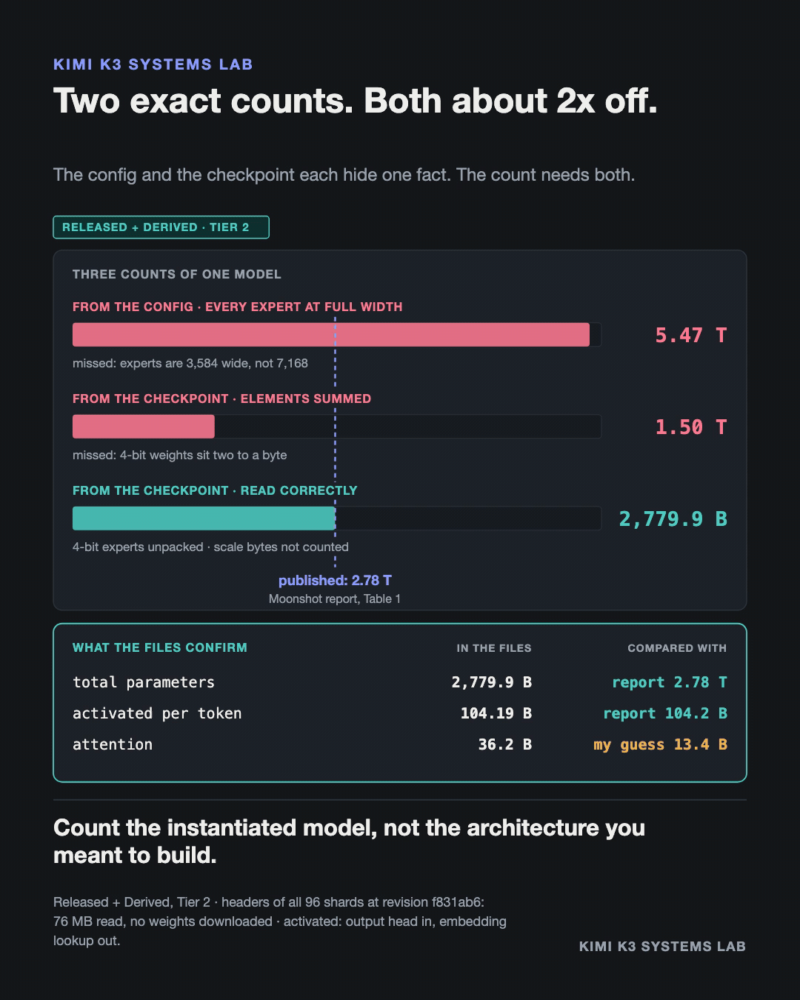

# Count what exists: Kimi K3's parameters, from the checkpoint

**Evidence class:** Released + Derived · **Tier:** 2 (released checkpoint inspected, headers only) · **Provenance:** my own derivation

## The claim

Two honest ways to count Kimi K3's parameters both miss by about 2x, in opposite directions. From
the config, with every routed expert at the model's 7,168 width: 5.47 trillion. Summing the element
counts of the released checkpoint's tensors: 1.50 trillion. Moonshot AI's technical report, Table 1:
2.78 trillion.

Each count misses one fact. The routed experts work in a 3,584-wide latent, and the checkpoint stores
them as MXFP4: two 4-bit weights per byte, next to scale tensors that are not parameters. Read with
both facts, the checkpoint holds 2,779.9 billion parameters.



```
$ python3 count_what_exists.py

  From the config, experts at full width:   5.47 T
  From the checkpoint, elements summed:      1.50 T
  From the checkpoint, read correctly:       2.7799 T   (report: 2.78 T)
  Activated per token, stated convention:    104.19 B   (report: 104.2 B)
```

## How it works without downloading the weights

A `.safetensors` file begins with an 8-byte length and a JSON header listing every tensor's name,
dtype, shape and byte span. The script reads only those bytes, with HTTP range requests, from all 96
shards of `moonshotai/Kimi-K3` at pinned revision `f831ab66814297da540d832a5235f8e904f29d06`:
75.8 MB of headers describing 1.5609 TB of weights.

Before counting, it checks that every shard's tensors tile its data section exactly, and that all
247,296 routed-expert matrices have the packed and scale shapes a 3,584-wide expert implies.

## What the script shows

1. **The checkpoint matches the published total.** 2,779.932 B against Table 1's 2.78 T (-0.002%).
   The language model alone is 2,779.5 B; the rest is a 0.45 B vision encoder.
2. **Both naive counts are exact arithmetic.** The config count is right for experts that do not
   exist; the element count is right for a storage format, not for parameters.
3. **Activated per token matches under one stated convention.** Counting the output head and not the
   input-embedding lookup gives 104.19 B against 104.2 B. The two other conventions are printed and
   do not match. The report does not state its convention, so this is consistency, not proof.
4. **The earlier config-only estimate missed exactly what it guessed.** That estimate (in
   [`../config-parameter-audit`](../config-parameter-audit)) came to 2.757 T. 98% of its 23.2 B
   shortfall is attention: it assumed the 69 linear-attention (KDA) layers were the size of the 24
   MLA layers. The files hold 36.2 B of attention, not 13.4 B.

## Boundary

Headers only. This establishes which tensors exist, their logical shapes and their storage format. It
says nothing about tensor values, how a serving engine stores or executes MXFP4 weights, or how much
GPU memory a deployment needs.

## Run it

```bash
python3 count_what_exists.py
```

Standard library only. The first run fetches about 76 MB of headers into `.headers/` (ignored by
git); later runs reuse them. The output reproduces `raw-output.txt` byte for byte.
