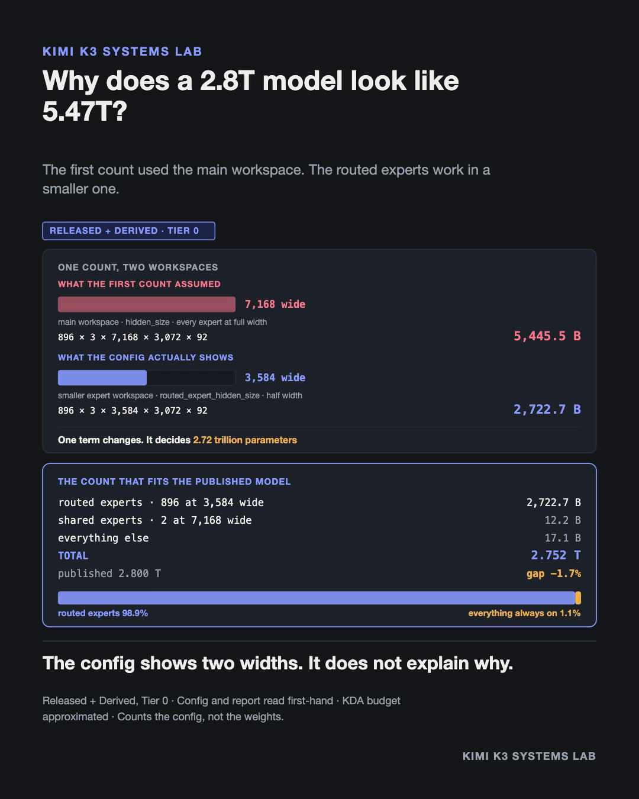

> **Superseded by [`../checkpoint-parameter-count`](../checkpoint-parameter-count) (2026-10-15).**
> This folder is the config-only estimate (2.757 T, -1.5% against the headline). Reading the
> released checkpoint's headers closed the gap: 2,779.9 B against the report's 2.78 T. The estimate's
> shortfall was almost entirely attention, the one size this script had to guess. Kept for the record.

# A config is a blueprint, not an inventory

**Evidence class:** Released + Derived · **Cost tier:** 0 (arithmetic) · **Provenance:** my own derivation

## The claim

Counting Kimi K3's parameters the obvious way — every expert an MLP over the 7,168-wide residual
stream — gives 5.47 trillion against a published 2.8 trillion. Nearly double. The multiplication is
correct. The architecture it describes is not the one that was built.



```
$ python3 count_the_config.py

  STEP 1 - COUNT IT THE OBVIOUS WAY
    routed experts         5445.48 B
    shared experts           12.16 B
    experts total          5457.64 B
    TOTAL                     5.47 T     Moonshot headline: 2.8 T
    Off by +95.5%.

  STEP 2 - THE DIMENSION THE COUNT ABOVE ASSUMED WRONG
    routed_expert_hidden_size: 3584

  STEP 3 - COUNT IT AGAIN
    routed experts (3,584 wide)      2722.74 B
    routed down + up projections        4.73 B
    shared experts (7,168 wide)        12.16 B
    TOTAL                              2.757 T
    Moonshot headline                  2.800 T
    gap vs headline                     -1.5 %
```

## What the script shows

1. **The naive count is exact arithmetic for a different model.** The 896 routed experts alone are
   5,445.5 B at 7,168 × 3,072 across 92 MoE layers. The two shared experts add 12.2 B, producing a
   5,457.6 B expert subtotal before anything else is counted. Nothing in that arithmetic is wrong
   except the width assigned to the routed experts.
2. **One released key carries the difference.** `hidden_size` is 7,168 and
   `routed_expert_hidden_size` is 3,584. Moonshot's technical report specifies the mapping: the
   routed branch projects the full-width input into a narrower latent, dispatches that to the
   selected routed experts, then projects the aggregate back. The two bias-free down/up matrices
   add 4.73 B across 92 MoE layers; the two shared experts stay full width.
3. **The corrected count lands at −1.5% of Moonshot's 2.8T headline**, from public values and
   arithmetic alone. The technical report separately rounds its architecture-table total to 2.78T.
   Neither figure is an input used to tune the derivation.
4. **A count that lands is also a budget, and this one is lopsided.** Routed experts are 2,722.7 B,
   **98.8%** of the corrected total; the **estimated non-routed budget** — including shared experts,
   attention, dense MLP, routers, embeddings, and down/up projections — is 33.9 B, the other 1.2%.
   The main hidden state is 7,168 wide; the routed path is 3,584 wide, and only 16 of its 896 experts fire for any given
   token. This is not the 104B activated-
   parameter figure: activated parameters are a separate per-token accounting that includes selected
   routed experts. The config shows two widths; it does not state the design rationale.

## Boundary

This counts the model the config **describes**. It is not a tensor inventory of the released
checkpoint; no shard was opened. Where the two disagree, the checkpoint wins.

Every input is labelled RELEASED in the script except one: the KDA attention projection budget is
an explicit approximation rather than a tensor inventory. The remaining −1.5% could come from that
approximation or from components this short count does not model. It is not explained here, and it
is not explained by the 104B activated-parameter figure either — the active count is a separate
accounting problem and is deliberately not used to close this gap.

Nothing here establishes why the authors chose the design.

## Sources

All read first-hand:

- `config.json` — https://huggingface.co/moonshotai/Kimi-K3/blob/main/config.json
- `modeling_kimi_linear.py` — https://huggingface.co/moonshotai/Kimi-K3/blob/main/modeling_kimi_linear.py
- Kimi K3 technical report, §2.3 — https://github.com/MoonshotAI/Kimi-K3/blob/main/k3_tech_report.pdf

## Run it

```bash
python3 count_the_config.py
```

Standard library only. The script asserts its own headline figures, so a transcription error fails
loudly rather than quietly shipping.
