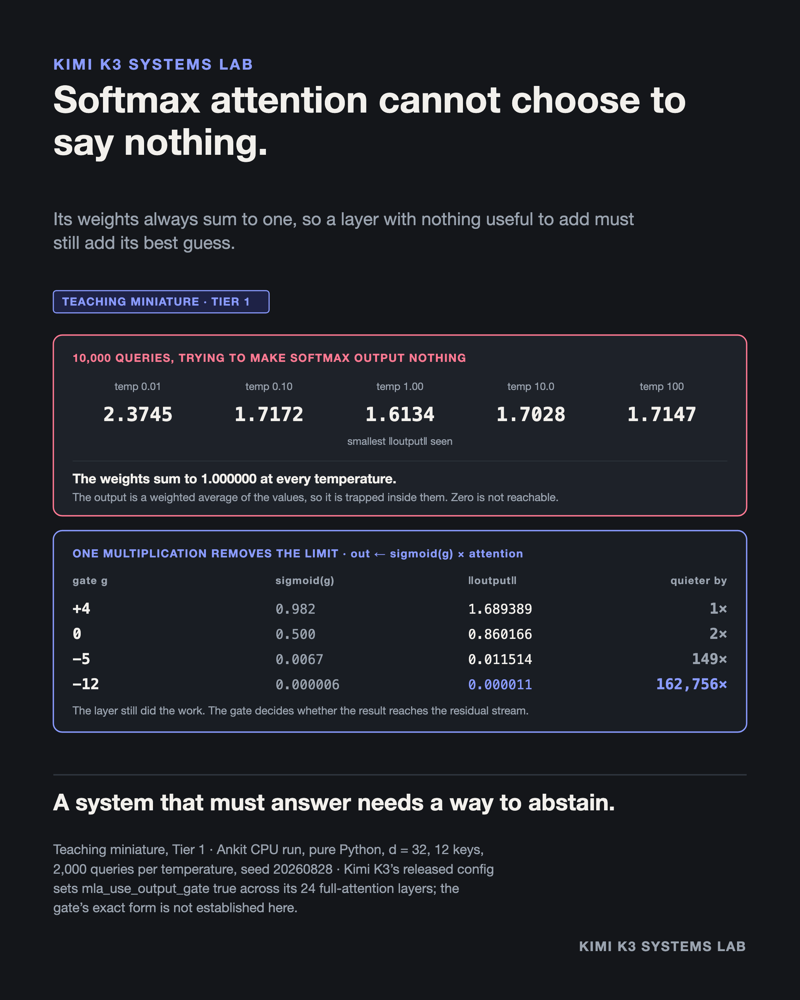

# Softmax attention cannot choose to say nothing

**Evidence class:** Teaching miniature · **Cost tier:** 1 (CPU) · **Provenance:** my own run

## The claim

Not "usually doesn't". Cannot. Softmax weights are non-negative and sum to exactly one, so a
layer's output is a weighted average of its value vectors and is trapped inside them. Zero is not
a value it can reach. A layer with nothing useful to add must still add its best guess, at full
strength.



```
$ python3 output_gate.py

   temperature |  min ||out|| |  mean ||out|| |  weights sum
          1.00 |       1.6134 |        1.7401 |     1.000000

  Across 10,000 queries the smallest output norm seen was 1.6134.

  gate g   sigmoid(g)   ||output||    quieter by
      +4        0.982     1.689389            1x
       0        0.500     0.860166            2x
      -5       0.0067     0.011514          149x
     -12     0.000006     0.000011      162,756x
```

## What the script shows

1. **The floor is a property of the function, not of the search.** 10,000 random unit queries
   across five temperatures spanning four orders of magnitude — the only lever a query really has —
   and nothing got under 1.6134. The weight sum prints as 1.000000 every time. That is what softmax
   is; no query can change it.
2. **This is a representational limit, not a training failure.** No amount of data fixes it,
   because the function has no zero to reach. Downstream layers cannot tell a forced contribution
   apart from a confident one.
3. **One multiplication removes it.** Scaling the output by a per-channel sigmoid lets the layer
   collapse its own contribution by 162,756x at a gate pre-activation of −12. **What does not
   change:** the attention weights still sum to one and the layer still did all of its work. The
   gate does not stop the computation. It decides whether the result reaches the residual stream.

## Boundary

A 32-dimensional single-head miniature with no trained weights, on random unit-norm keys. It
demonstrates a property of the softmax function and of a gated output. It measures nothing about
Kimi K3's behaviour, accuracy, or quality.

The gate demonstration sweeps the sigmoid directly. It is not a trained parameter, so it shows the
mechanism rather than any learned value.

Kimi K3's released `config.json` sets `mla_use_output_gate: true` across its 24 full-attention
layers, so the gate is a released fact rather than an inference from behaviour. What is **not**
established is its exact form: whether it is per-channel, what produces it, or what values it
learns. Nothing here answers that.

## Sources

- `config.json`, read first-hand — https://huggingface.co/moonshotai/Kimi-K3/blob/main/config.json

## Run it

```bash
python3 output_gate.py
```

Standard library only. The script asserts its own headline figures.
